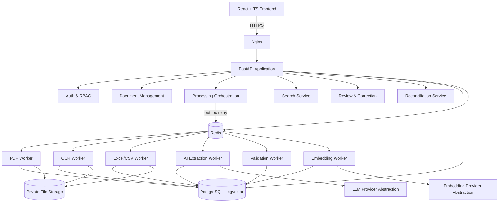
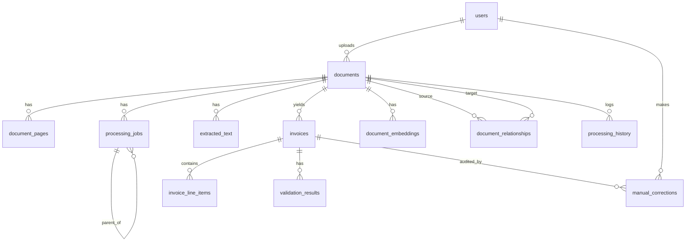

# Architecture

## 1. Style

Modular monolith (one FastAPI deployable) plus independently scalable Celery workers. Modules communicate through service interfaces, not through each other's tables. No microservices: the team and workload do not justify the operational cost.

## 2. Diagram

## 3. Component Responsibilities

| Component | Responsibility |
|-----------|----------------|
| `api` | HTTP routing, request/response schemas, dependency wiring. No business logic. |
| `security` | JWT auth, password hashing, RBAC dependencies, upload sanitization, rate limiting. |
| `services/documents` | Upload intake, validation, storage, soft delete, signed/authorized download. |
| `services/orchestration` | Creates jobs, writes outbox rows, tracks state machine, retry/cancel logic. |
| `processors/*` | One processor per format behind a common `DocumentProcessor` interface: validate, inspect, extract, emit structured per-page/per-sheet results. |
| `services/extraction` | Prompt rendering, LLM call, schema validation, retry/fallback, confidence and source-reference assembly. |
| `services/validation` | Deterministic `Decimal` rule engine; each rule is an isolated, unit-tested class. |
| `services/reconciliation` | Matching strategies (exact, then controlled fuzzy), discrepancy generation, match-status workflow. |
| `services/search` | FTS, filters, vector similarity, hybrid ranking (reciprocal rank fusion). |
| `services/review` | Corrections, audit trail, approval state transitions. |
| `workers` | Celery tasks: thin wrappers calling services; own retries, timeouts, idempotency keys. |
| `repositories` | All SQLAlchemy queries. Services never build raw queries. |

## 4. Processing Workflow and State Machine

Document status: `uploaded -> validating -> classified -> extracting_text -> ai_extracting -> validating_financials -> embedding -> needs_review | processed -> approved`, with `failed` and `cancelled` reachable from any in-flight state.

Key rules:
1. "Processed" requires text extracted AND structured extraction schema-valid AND validation executed. Text extraction alone is not success.
2. Each stage is a job row with `idempotency_key = sha256(document_id, stage, input_hash, pipeline_version)`. Re-running a completed stage with the same key is a no-op.
3. PDFs are split into page batches (default 20 pages). Each batch is its own sub-job; progress is `pages_done / pages_total`. A worker crash loses at most one batch.
4. Transactional outbox: the API transaction inserts the job row and an `outbox` event atomically; a relay publishes to Celery and marks delivery, so a Redis outage never loses a job.
5. Retries: exponential backoff with jitter, max attempts per stage, then `dead` status (visible dead-letter list in UI with manual retry).
6. Timeouts: soft and hard time limits per task type; cancellation sets a flag checked between page batches.

## 5. Database Entities and Relationships

Tables (all UUID PKs, `created_at`, `updated_at`; soft delete via `deleted_at` where noted):

| Table | Key columns | Notes |
|-------|-------------|-------|
| users | email (unique), password_hash, role, is_active | |
| documents | owner_id, original_filename, storage_key, sha256 (unique per live doc), mime_type, size_bytes, page_count, doc_type, status, metadata JSONB, deleted_at | content hash enables upload dedup |
| document_pages | document_id, page_number, kind (digital/scanned/sheet/csv), ocr_confidence, text_chars, status, error | unique (document_id, page_number) |
| processing_jobs | document_id, parent_job_id, stage, status, attempts, idempotency_key (unique), page_start, page_end, error, started_at, finished_at | |
| outbox | job_id, payload JSONB, published_at | transactional outbox |
| extracted_text | document_id, page_number, text, source (native/ocr), ocr_confidence, tsvector (generated, GIN) | |
| invoices | document_id, invoice_number, invoice_date, supplier_name, customer_name, subtotal, tax, total (NUMERIC(18,4)), currency, confidence JSONB, source_references JSONB, raw_extraction JSONB, model_name, model_version, prompt_version, requires_review, review_status, source_kind, version (optimistic lock), deleted_at | NULL means unknown |
| invoice_line_items | invoice_id, line_no, description, quantity, unit_price, tax, total, confidence JSONB, source_references JSONB | |
| validation_results | invoice_id, rule_id, severity, expected, actual, description, source_references JSONB, resolution_status, resolved_by, resolved_at | |
| document_relationships | source_document_id, target_document_id, relation_type, match_method, match_score, status (proposed/confirmed/rejected), discrepancies JSONB | reconciliation result store |
| document_embeddings | document_id, page_number, chunk_index, chunk_text, embedding vector(384), model_name | HNSW index |
| outbox | job_id, payload JSONB, published_at | transactional outbox (see section 4) |
| refresh_tokens | user_id, token_hash, expires_at, revoked_at | supports revocation (TD-12) |
| manual_corrections | invoice_id, line_item_id, field_name, old_value, new_value, reason, user_id | append-only |
| processing_history | document_id, job_id, event, detail JSONB, actor | append-only |

Indexes: non-unique composite B-tree on (invoice_number, supplier_name, invoice_date) to make duplicate lookups fast (no unique constraint, see TD-9); GIN on tsvector and on `metadata`; B-tree on status, supplier, date, total; HNSW on embedding (cosine).

Duplicate policy: a database uniqueness constraint would block rather than flag. Duplicates are therefore detected by a validation rule and linked via `document_relationships(relation_type='duplicate_of')`; nothing is deleted.

## 6. API Surface

As defined in the master prompt, under `/api/v1`. Conventions:
- Pagination: `?page=&page_size=` (max 100), response `{items, total, page, page_size}`.
- Filtering/sorting: `?status=&doc_type=&date_from=&date_to=&sort=-created_at`.
- Errors: `{error: {code, message, details, request_id}}`.
- Auth: Bearer JWT (short-lived access + refresh); roles enforced by dependencies.
- Long operations return `202 Accepted` with a `job_id`.
- Added beyond the prompt: `POST /auth/login`, `POST /auth/refresh`, `GET /documents/{id}/file` (authorized streaming download), `GET /jobs?document_id=`, `GET /dashboard/stats`, `GET /documents/{id}/history`.

## 7. Extraction Design

1. Per-page text assembled with page markers so references survive chunking.
2. Prompt (versioned, stored in config files) instructs: return JSON only, `null` when absent, quote the evidence text per field.
3. Response parsed into Pydantic models; failure -> one repair retry -> fallback provider/model -> `requires_review`.
4. Evidence check: each non-null field's quoted evidence must appear in the source text (normalized). Fields failing this check are downgraded in confidence and flagged. This is the main anti-hallucination control.
5. Confidence = combination of OCR confidence of the source page, evidence-match, and format-validity; kept separate from OCR confidence in storage.
6. Normalizers (not the LLM) parse dates and money into `date`/`Decimal`, including Bengali digits and lakh/crore grouping.

## 8. Validation Engine

Rule interface: `Rule.evaluate(invoice, context) -> list[ValidationResult]`. Rules registered in a registry; configuration supplies tolerance, rounding, required fields, date bounds. All arithmetic via `Decimal` with an explicit context. Rules never call the LLM.

## 9. Reconciliation

Strategies, in order: (1) exact normalized invoice number + supplier; (2) exact invoice number only; (3) fuzzy (token-normalized invoice number, supplier similarity, amount and date proximity) producing a score. Scores above a high threshold are proposed as `proposed` matches, never auto-confirmed; only exact matches may be auto-confirmed, and still field differences are reported as discrepancies. Spreadsheet/CSV rows are first normalized into invoice records so one comparator serves all pairings.

## 10. Search

Keyword: `websearch_to_tsquery` over `extracted_text.tsv`. Semantic: query embedding, cosine over `document_embeddings`. Hybrid: reciprocal rank fusion of both lists, with SQL filters applied before ranking. Exact invoice-number queries short-circuit to indexed lookup.

## 11. Security Architecture

- Upload: extension allowlist + magic-byte sniffing + size cap + PDF/Office structure checks; reject encrypted or macro-enabled inputs (XLSM) by default; parse in worker processes with resource limits.
- Storage: server-generated random keys, never user filenames; resolved path must remain under storage root; files never served statically.
- Authz: RBAC dependencies per route; downloads stream through the API after permission check.
- Secrets: environment only, `.env.example` with placeholders, startup fails loudly on missing production secrets.
- Rate limiting: Redis token bucket on auth and upload routes.
- Audit: append-only `manual_corrections` and `processing_history`; auth events logged.
- Data egress: document text sent to the configured LLM provider; provider selection and a redaction hook are documented as a deployment decision.

## 12. Performance Considerations

- Page-batch processing: open PDF per batch with PyMuPDF, render only pages needing OCR, release pixmaps immediately.
- Bounded Celery prefetch (1) and per-queue concurrency; OCR queue separated from light queues.
- Bulk inserts for pages and text; connection pooling; indexes listed above.
- Embeddings generated in batches per document, after validation, so failed documents don't waste compute.
- All performance claims to be produced by the benchmark script in Phase 12/13, not asserted.
